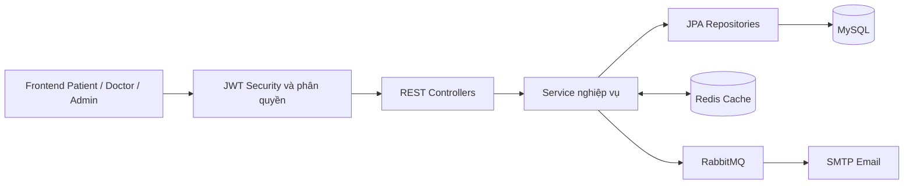

# Hệ thống đặt lịch khám bệnh

Ứng dụng web quản lý đặt lịch khám cho ba nhóm người dùng: **Bệnh nhân**, **Bác sĩ** và **Quản trị viên**. Backend được xây dựng bằng Spring Boot theo kiến trúc phân tầng; frontend dùng HTML, CSS và JavaScript thuần, được Spring Boot phục vụ trực tiếp.

## Chức năng chính

### Bệnh nhân

- Đăng ký, đăng nhập và làm mới JWT token.
- Xem, cập nhật hồ sơ cá nhân và tiền sử bệnh.
- Tìm bác sĩ theo tên hoặc chuyên khoa, xem chi tiết và lịch trống.
- Đặt lịch, nhập triệu chứng ban đầu và nhận email xác nhận bất đồng bộ.
- Xem lịch sử, hủy lịch đúng thời hạn và xem hồ sơ khám bệnh.

### Bác sĩ

- Đăng ký tài khoản và chờ Admin duyệt.
- Quản lý hồ sơ chuyên môn, giá khám và ca làm việc.
- Xem lịch hẹn, bệnh nhân đã khám và cập nhật trạng thái buổi khám.
- Ghi chẩn đoán và ghi chú vào hồ sơ bệnh án.

### Quản trị viên

- Duyệt hoặc từ chối tài khoản bác sĩ.
- Quản lý bác sĩ, bệnh nhân, chuyên khoa và dịch vụ khám.
- Khóa hoặc mở khóa tài khoản.
- Xem thống kê lịch hẹn và doanh thu theo ngày, tháng, bác sĩ.

## Công nghệ sử dụng

| Thành phần | Công nghệ |
|---|---|
| Backend | Java 21, Spring Boot 3.3.2, Maven |
| Bảo mật | Spring Security, JWT, BCrypt, phân quyền theo vai trò |
| Cơ sở dữ liệu | MySQL 8, Spring Data JPA, Hibernate |
| Cache | Redis 7 |
| Message Queue | RabbitMQ 3 |
| Email | Spring Mail, SMTP |
| Frontend | HTML5, CSS3, JavaScript, Bootstrap 5 |
| Kiểm thử | JUnit 5, Spring Boot Test, H2, MockMvc |

## Kiến trúc tổng quan



Luồng đặt lịch dùng pessimistic lock trên slot khám để ngăn hai bệnh nhân đặt trùng cùng một ca. Sự kiện email chỉ được phát sau khi giao dịch đặt lịch thành công.

## Cấu trúc thư mục

```text
dat-lich-kham-benh-main/
├── backend/                         # Ứng dụng Spring Boot
│   ├── src/main/java/               # Controller, Service, Repository, Entity, Security
│   ├── src/main/resources/static/   # Frontend được Spring Boot phục vụ
│   └── src/test/                    # Unit test và integration test
├── frontend/                        # Mã nguồn giao diện độc lập
├── architecture.md                  # Quy ước kiến trúc 5 tầng
├── schema.md                        # Mô tả schema và quan hệ dữ liệu
├── docker-compose.yml               # MySQL, Redis và RabbitMQ
├── run.bat                          # Chạy nhanh trên Windows với profile dev
└── DatLichKhamBenh.postman_collection.json
```

Hai thư mục `frontend/` và `backend/src/main/resources/static/` đang chứa cùng một phiên bản giao diện. Khi chạy Spring Boot, giao diện trong thư mục `static/` được phục vụ tại cổng của backend và không cần cài Node.js.

## Yêu cầu môi trường

Cài đặt các công cụ sau trước khi chạy:

- Git.
- JDK 21 trở lên.
- Maven 3.9 trở lên.
- Docker Desktop hoặc Docker Engine có Docker Compose v2.

Kiểm tra nhanh:

```bash
git --version
java -version
mvn -version
docker --version
docker compose version
```

## Clone dự án

Thay `<URL_REPOSITORY>` bằng URL GitHub/GitLab thực tế của dự án:

```bash
git clone <URL_REPOSITORY>
cd dat-lich-kham-benh-main
```

## Chạy nhanh môi trường phát triển

### Windows

Tại thư mục gốc dự án:

```powershell
docker compose up -d
.\run.bat
```
```
Hậu đẹp trai
```

### Linux hoặc macOS

```bash
docker compose up -d
cd backend
SPRING_PROFILES_ACTIVE=dev mvn spring-boot:run
```

Profile `dev` sử dụng khóa JWT dành riêng cho local và tự tạo dữ liệu mẫu nếu chưa tồn tại. Không dùng profile này cho production.

Sau khi log xuất hiện thông báo `Started BackendApplication`, mở:

| Dịch vụ | Địa chỉ |
|---|---|
| Ứng dụng | [http://localhost:8080](http://localhost:8080) |
| Trang đăng nhập | [http://localhost:8080/login.html](http://localhost:8080/login.html) |
| Health check | [http://localhost:8080/actuator/health](http://localhost:8080/actuator/health) |
| RabbitMQ Management | [http://localhost:15672](http://localhost:15672) |

Tài khoản RabbitMQ local mặc định là `guest` / `guest`.

## Các dịch vụ Docker

`docker-compose.yml` chỉ khởi chạy hạ tầng; backend vẫn chạy bằng Maven hoặc file JAR.

| Dịch vụ | Container | Cổng máy host |
|---|---|---|
| MySQL | `clinic_mysql` | `3307` |
| Redis | `clinic_redis` | `6379` |
| RabbitMQ AMQP | `clinic_rabbitmq` | `5672` |
| RabbitMQ Management | `clinic_rabbitmq` | `15672` |

Kiểm tra trạng thái:

```bash
docker compose ps
```

Dừng hạ tầng nhưng giữ dữ liệu:

```bash
docker compose down
```

## Chạy backend thủ công

### Chạy trực tiếp bằng Maven

PowerShell:

```powershell
cd backend
$env:SPRING_PROFILES_ACTIVE = "dev"
mvn spring-boot:run
```

Bash:

```bash
cd backend
SPRING_PROFILES_ACTIVE=dev mvn spring-boot:run
```

### Đóng gói và chạy file JAR

```bash
cd backend
mvn clean package
```

PowerShell:

```powershell
$env:SPRING_PROFILES_ACTIVE = "dev"
java -jar target/backend-0.0.1-SNAPSHOT.jar
```

Bash:

```bash
SPRING_PROFILES_ACTIVE=dev java -jar target/backend-0.0.1-SNAPSHOT.jar
```

## Cấu hình môi trường

Các giá trị local mặc định khớp với `docker-compose.yml`.

| Biến | Mặc định | Ý nghĩa |
|---|---|---|
| `SERVER_PORT` | `8080` | Cổng HTTP của ứng dụng |
| `DB_URL` | MySQL tại `localhost:3307/datlichkhambenh` | JDBC URL |
| `DB_USERNAME` | `root` | Tài khoản MySQL |
| `DB_PASSWORD` | `root` | Mật khẩu MySQL |
| `REDIS_HOST` | `localhost` | Máy chủ Redis |
| `REDIS_PORT` | `6379` | Cổng Redis |
| `RABBITMQ_HOST` | `localhost` | Máy chủ RabbitMQ |
| `RABBITMQ_PORT` | `5672` | Cổng AMQP |
| `RABBITMQ_USERNAME` | `guest` | Tài khoản RabbitMQ |
| `RABBITMQ_PASSWORD` | `guest` | Mật khẩu RabbitMQ |
| `JWT_SECRET` | Không có ở profile thường | Khóa ký JWT, bắt buộc ngoài môi trường dev/test |
| `JWT_EXPIRATION_MS` | `86400000` | Thời hạn access token, mặc định 24 giờ |
| `JWT_REFRESH_EXPIRATION_MS` | `604800000` | Thời hạn refresh token, mặc định 7 ngày |
| `MAIL_HOST` | `smtp.gmail.com` | SMTP server |
| `MAIL_PORT` | `587` | Cổng SMTP |
| `MAIL_USERNAME` | Trống | Tài khoản gửi email |
| `MAIL_PASSWORD` | Trống | Mật khẩu ứng dụng SMTP |

Ví dụ cấu hình PowerShell trước khi chạy ở môi trường không dùng profile `dev`:

```powershell
$env:JWT_SECRET = "thay-bang-khoa-bi-mat-ngau-nhien-it-nhat-32-ky-tu"
$env:DB_PASSWORD = "mat-khau-mysql"
$env:MAIL_USERNAME = "your-account@gmail.com"
$env:MAIL_PASSWORD = "your-google-app-password"
mvn spring-boot:run
```

Không commit khóa JWT, mật khẩu cơ sở dữ liệu hoặc mật khẩu SMTP thật lên Git.

## Cấu hình gửi email

Đặt lịch vẫn thành công khi chưa cấu hình SMTP, nhưng email thực tế chỉ được gửi khi có `MAIL_USERNAME` và `MAIL_PASSWORD` hợp lệ. Với Gmail, sử dụng **App Password**, không dùng mật khẩu đăng nhập thông thường.

Luồng xử lý:

```text
Đặt lịch thành công -> phát sự kiện sau commit -> RabbitMQ queue
-> Email consumer -> SMTP server -> hộp thư bệnh nhân
```

Queue mặc định: `clinic.email.queue`.

## Tài khoản mẫu

Các tài khoản sau chỉ được tạo khi chạy profile `dev` và dữ liệu chưa tồn tại.

| Vai trò | Email | Mật khẩu |
|---|---|---|
| Admin | `admin@clinic` | `admin@2026` |
| Admin | `admin@clinic.vn` | `Admin@123` |
| Bác sĩ | `doctor@clinic` | `doctor@2026` |
| Bác sĩ | `bs.nguyenvana@clinic.vn` | `Doctor@123` |
| Bác sĩ | `bs.tranthib@clinic.vn` | `Doctor@123` |
| Bác sĩ | `bs.lephuongc@clinic.vn` | `Doctor@123` |
| Bác sĩ | `bs.phamminhd@clinic.vn` | `Doctor@123` |
| Bác sĩ | `bs.vothuyt@clinic.vn` | `Doctor@123` |
| Bác sĩ | `bs.dangquoch@clinic.vn` | `Doctor@123` |
| Bác sĩ | `bs.ngobichn@clinic.vn` | `Doctor@123` |
| Bệnh nhân | `patient@clinic` | `user@2026` |
| Bệnh nhân | `bn.hoangminh@gmail.com` | `Patient@123` |
| Bệnh nhân | `bn.thuylinh@gmail.com` | `Patient@123` |
| Bệnh nhân | `bn.tranvannam@gmail.com` | `Patient@123` |
| Bệnh nhân | `bn.lethimai@gmail.com` | `Patient@123` |

Mật khẩu được lưu trong MySQL dưới dạng BCrypt hash. Không sử dụng các tài khoản mẫu trong production.

## API và Postman

Base URL:

```text
http://localhost:8080/api/v1
```

Các nhóm endpoint chính:

| Nhóm | Base path |
|---|---|
| Xác thực | `/api/v1/auth` |
| Bệnh nhân | `/api/v1/patients` |
| Bác sĩ và lịch làm việc | `/api/v1/doctors` |
| Đặt lịch | `/api/v1/appointments` |
| Dịch vụ khám | `/api/v1/services` |
| Quản trị | `/api/v1/admin` |

Import file `DatLichKhamBenh.postman_collection.json` vào Postman để thử API. Sau khi đăng nhập, dùng access token trong header:

```http
Authorization: Bearer <access-token>
```

## Chạy kiểm thử

Bộ test sử dụng H2 in-memory và profile `test`, không cần khởi động MySQL, Redis hoặc RabbitMQ thật.

```bash
cd backend
mvn test
```

Đóng gói và chạy toàn bộ kiểm thử:

```bash
mvn clean package
```

## Chạy frontend riêng khi phát triển

Frontend không cần bước build. Có thể mở thư mục `frontend/` bằng Live Server tại `http://localhost:5500`; backend vẫn phải chạy ở `http://localhost:8080`. CORS mặc định cho phép các origin local `localhost:5500` và `127.0.0.1:5500`.

Khi hoàn tất thay đổi giao diện, đồng bộ các tệp sang `backend/src/main/resources/static/` để bản Spring Boot sử dụng đúng phiên bản mới.

## Làm mới dữ liệu local

Lệnh sau xóa toàn bộ volume MySQL, Redis và RabbitMQ của dự án. Chỉ chạy khi chấp nhận mất toàn bộ dữ liệu local:

```bash
docker compose down -v
docker compose up -d
```

Sau đó chạy lại backend với profile `dev` để tạo schema và dữ liệu mẫu.

## Xử lý lỗi thường gặp

### Backend không kết nối được MySQL

- Kiểm tra `docker compose ps` và container `clinic_mysql`.
- Xác nhận cổng MySQL là `3307`, không phải `3306`.
- Kiểm tra `DB_URL`, `DB_USERNAME` và `DB_PASSWORD`.

### Cổng 8080 đã được sử dụng

Đóng tiến trình đang chiếm cổng hoặc đặt cổng khác:

```powershell
$env:SERVER_PORT = "8081"
.\run.bat
```

### Không nhận được email xác nhận

- Kiểm tra RabbitMQ tại `http://localhost:15672`.
- Kiểm tra queue `clinic.email.queue` có consumer hay không.
- Cấu hình `MAIL_USERNAME` và `MAIL_PASSWORD` hợp lệ.
- Với Gmail, kiểm tra App Password và xác thực hai bước.

### Thay đổi frontend nhưng giao diện không cập nhật

- Kiểm tra tệp đã được đồng bộ vào `backend/src/main/resources/static/`.
- Khởi động lại backend sau khi đóng gói JAR.
- Hard refresh trình duyệt để bỏ cache cũ.

## Tài liệu liên quan

- `architecture.md`: mô tả trách nhiệm từng tầng và luồng booking.
- `schema.md`: mô tả bảng, khóa ngoại và ràng buộc dữ liệu.
- `DatLichKhamBenh.postman_collection.json`: collection kiểm thử API.

## Lưu ý production

- Không chạy với profile `dev`.
- Bắt buộc cung cấp `JWT_SECRET` đủ mạnh và ngẫu nhiên.
- Không dùng tài khoản/mật khẩu mẫu hoặc tài khoản RabbitMQ `guest`.
- Dùng migration tool như Flyway hoặc Liquibase và đặt `JPA_DDL_AUTO=validate`.
- Chỉ cho phép CORS từ domain frontend thực tế.
- Bật HTTPS, quản lý secret bằng biến môi trường hoặc secret manager.
- Cấu hình backup MySQL, giám sát health/metrics và chính sách lưu log.
